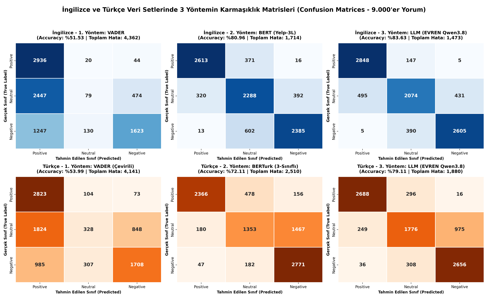
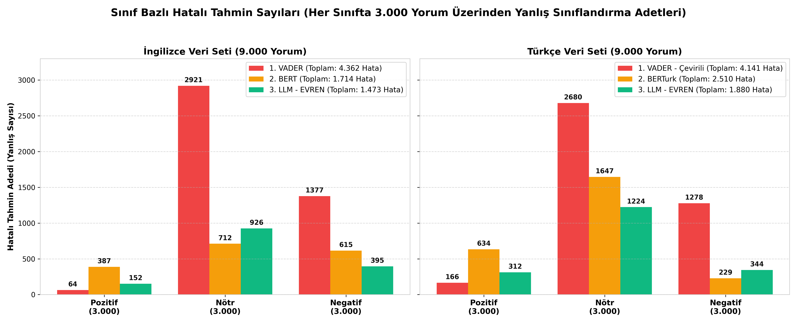
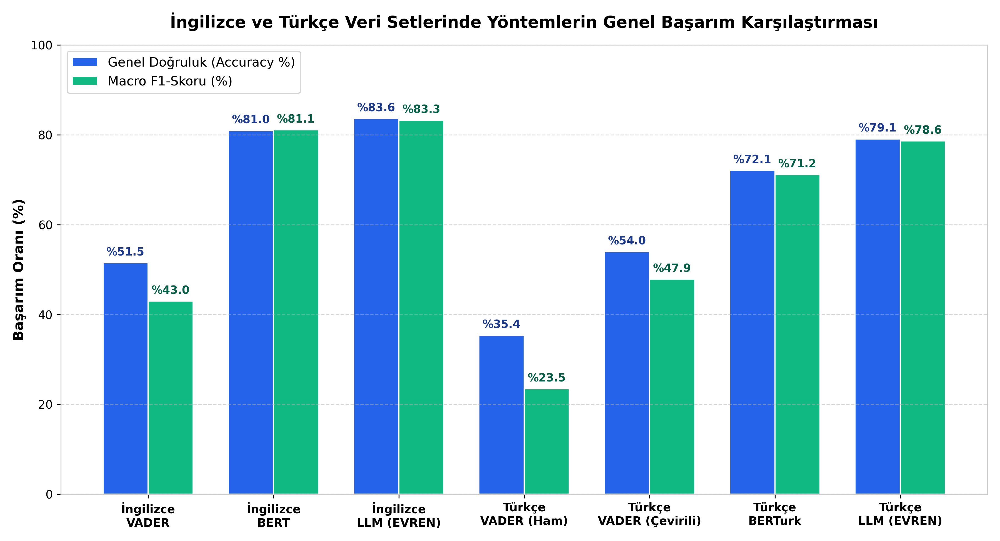

# BİM448 Veri Madenciliği ve Bilgi Keşfi — Karşılaştırmalı Duygu Analizi (Sentiment Analysis)

**Hazırlayanlar:**
* **Eren Aksoy** — `202403011009`
* **Emre Kayıkcı** — `202403011068`

Bu proje, **Doğuş Üniversitesi Bilgisayar Mühendisliği Bölümü BİM448 Veri Madenciliği ve Bilgi Keşfi** dersi kapsamında; geleneksel/kural tabanlı (**VADER**), derin öğrenme tabanlı (**BERT / BERTurk**) ve Büyük Dil Modeli tabanlı (**LLM – EVREN API `qwen3.8-flash-next`**) duygu analizi yöntemlerinin başarımını **9.000 İngilizce** ve **9.000 Türkçe** (toplam **18.000**) gerçek restoran ve kafe yorumu üzerinde karşılaştırmalı olarak incelemektedir.

---

## 📊 Deneysel Sonuçlar Özeti (18.000 Yorum)

Her iki dilde de sınıf başına **3.000'er adet (`Positive`: 3.000, `Neutral`: 3.000, `Negative`: 3.000)** dengeli örneklem üzerinde elde edilen sınıf bazlı hatalı tahmin sayıları ve genel doğruluk oranları:

| Dil ve Yöntem | Pozitif Hata (3.000'de) | Nötr Hata (3.000'de) | Negatif Hata (3.000'de) | **Toplam Hatalı Tahmin (9.000'de)** | **Genel Doğruluk (Accuracy)** | **Macro F1-Skoru** |
| :--- | :---: | :---: | :---: | :---: | :---: | :---: |
| **🇬🇧 İngilizce – 1. VADER** | 64 | 2.921 | 1.377 | **4.362** | %51,53 | %39,65 |
| **🇬🇧 İngilizce – 2. BERT (`gohbwj/sentiment-fine-tuned-yelp-3L`)** | 387 | 712 | 615 | **1.714** | %80,96 | %81,11 |
| **🇬🇧 İngilizce – 3. LLM (`EVREN - qwen3.8-flash-next`)** | 152 | 926 | 395 | **1.473** | **%83,63** | **%83,35** |
| **🇹🇷 Türkçe – 1A. VADER (Çevirisiz Ham)** | 2.669 | 182 | 2.966 | **5.817** | %35,37 | %24,47 |
| **🇹🇷 Türkçe – 1B. VADER (İngilizceye Çevirili)** | 177 | 2.672 | 1.292 | **4.141** | %53,99 | %45,15 |
| **🇹🇷 Türkçe – 2. BERTurk (`incidelen/bert-base-turkish-sentiment-analysis-cased`)** | 634 | 1.647 | 229 | **2.510** | %72,11 | %71,18 |
| **🇹🇷 Türkçe – 3. LLM (`EVREN - qwen3.8-flash-next`)** | 312 | 1.224 | 344 | **1.880** | **%79,11** | **%78,56** |

---

## 📈 Karşılaştırmalı Grafikler

### 1. Altılı Karmaşıklık Matrisi (Confusion Matrices)

### 2. Sınıf Bazlı Hatalı Tahmin Sayıları

### 3. Genel Doğruluk (Accuracy) ve Macro F1-Skoru Karşılaştırması

---

## 📁 Klasör Yapısı

* **`Veri_Setleri/`**
  * `english_restaurant_reviews_9000.csv`: 9.000 İngilizce Yelp Restoran & Kafe yorumu (`3.000 Positive`, `3.000 Neutral`, `3.000 Negative`)
  * `turkish_restaurant_reviews_9000.csv`: 9.000 Türkçe Google Maps Restoran & Kafe yorumu (`3.000 Positive`, `3.000 Neutral`, `3.000 Negative`)
  * `prepare_datasets.py`: Veri indirme, temizleme ve dengeli örneklem oluşturma modülü
* **`1_Yontem_VADER/`**
  * `method1_vader.py` & `Bim448_Method1_VADER.ipynb`: VADER duygu analizi kodları
  * `vader_english_results.csv`, `vader_turkish_results.csv`, `vader_summary_metrics.json`: Tahmin çıktıları ve metrikler
* **`2_Yontem_BERT/`**
  * `method2_bert.py` & `Bim448_Method2_BERT_Colab.ipynb`: 3 sınıflı BERT ve BERTurk derin öğrenme analizi kodları
  * `bert_english_results.csv`, `bert_turkish_results.csv`, `bert_summary_metrics.json`: Tahmin çıktıları ve metrikler
* **`3_Yontem_LLM/`**
  * `method3_llm.py` & `Bim448_Method3_LLM_Colab.ipynb`: EVREN API (`qwen3.8-flash-next`) yapılandırılmış istem mühendisliği (batch prompting) kodları
  * `llm_english_results.csv`, `llm_turkish_results.csv`, `llm_summary_metrics.json`: Tahmin çıktıları ve metrikler
* **`4_Rapor_ve_Gorseller/`**
  * `BIM448_Proje_Raporu.docx`: Proje raporu Word dokümanı
  * `generate_charts_and_report.py`: Yüksek çözünürlüklü (300 DPI) grafik ve rapor üretim modülü
  * `1_confusion_matrices_6panel.png`, `2_accuracy_and_f1_comparison.png`, `3_class_wise_error_counts.png`, `4_turkish_translation_impact_vader.png`
